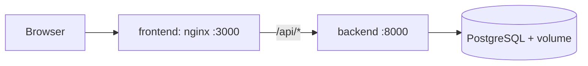
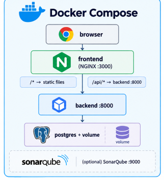
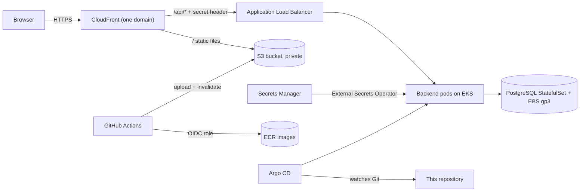
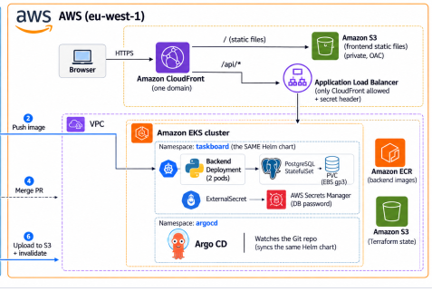

# TaskBoard: from local to production on AWS

TaskBoard is a small task manager (Next.js frontend, Python FastAPI backend, PostgreSQL database).
This repository contains everything needed to run it: Docker images, a Docker Compose stack, a Helm chart,
a local Kubernetes setup (minikube), the AWS infrastructure as Terraform code, GitHub Actions pipelines with
security scans, and Argo CD for GitOps delivery.

The project has two parts:

- **Part A (Local):** containers, Docker Compose, local security scans, Helm chart, minikube, Argo CD on minikube.
- **Part B (AWS):** Terraform, EKS, CloudFront + S3, ALB, GitHub Actions, Argo CD on EKS, releases.

## Architecture

### Local




Locally, nginx plays the role of CloudFront: it serves the static frontend and forwards `/api/*` to the backend.

### AWS (eu-west-1)




- **One domain for everything:** CloudFront serves the static files from S3 and forwards `/api/*` to the backend, so there is no CORS and no mixed content.
- **The ALB is locked to CloudFront:** its security group only accepts CloudFront's IP list, and its listener only forwards requests that carry a secret `X-Origin-Verify` header. Anything else gets a 403.
- **Terraform owns the ALB, Kubernetes owns the pods:** a `TargetGroupBinding` (AWS Load Balancer Controller) registers the backend pod IPs in the target group that Terraform created.
- **No passwords in Git:** Terraform generates the database password, stores it in AWS Secrets Manager, and the External Secrets Operator copies it into the cluster.
- **No AWS keys in GitHub:** workflows log in with OpenID Connect (OIDC) roles.

The same Helm chart and the same images are used locally and on AWS. Only the values files differ
(`values-local.yaml` and `values-prod.yaml`).

## Repository layout

| Folder | What it contains |
|---|---|
| `app/` | Provided source code: `backend/` (FastAPI) and `frontend/` (Next.js), each with a Dockerfile |
| `local-setup/` | `docker-compose.yml`, `minikube/up.sh` and `down.sh`, local README |
| `deploy/helm/taskboard/` | Helm chart: backend, PostgreSQL StatefulSet, secrets, TargetGroupBinding, helm test |
| `infra/bootstrap/` | Run once from a laptop: state bucket, GitHub OIDC provider, infra role. Also holds the reusable `modules/` |
| `infra/environments/prod/` | The production environment, built from the modules |
| `gitops/` | Argo CD Application files and `install-argocd.sh` |
| `.github/actions/` | Composite actions: `pre-build-scan` and `post-build-scan` |
| `.github/workflows/` | `backend.yml`, `frontend.yml`, `helm.yml`, `release.yml`, `infra-cd.yml` |

## Run it locally

Requirements: `git`, `docker`, `kubectl`, `helm`, `minikube`.

### Docker Compose

```bash
cd local-setup
docker compose up --build
```

Open http://localhost:3000 and add, complete and delete tasks. The API docs are at http://localhost:8000/api/docs.

```bash
docker compose down        # stop, keep the data
docker compose down -v     # stop and delete the data
```

Tasks survive `docker compose restart backend` and `docker compose down` followed by `up`.
SonarQube (optional): `docker compose --profile sonar up -d`, then open http://localhost:9000.

### Local security scans (run from the repository root)

```bash
docker run --rm -v "$PWD:/src" ghcr.io/gitleaks/gitleaks:v8.30.1 dir /src --redact
docker run --rm -v "$PWD:/src" trufflesecurity/trufflehog:3.99.2 filesystem /src
docker run --rm -v "$PWD:/src" aquasec/trivy:0.75.0 fs /src --scanners vuln,secret,misconfig --severity HIGH,CRITICAL --ignorefile /src/.trivyignore
docker build --pull -t taskboard-backend:local app/backend
docker run --rm -v /var/run/docker.sock:/var/run/docker.sock aquasec/trivy:0.75.0 image taskboard-backend:local --severity HIGH,CRITICAL --ignore-unfixed
```

### Kubernetes on minikube

```bash
./local-setup/minikube/up.sh            # build the image, load it into minikube, helm install, helm test
./local-setup/minikube/up.sh argocd     # same, but Argo CD deploys the chart from Git
./local-setup/minikube/down.sh          # delete the minikube profile
```

`up.sh` ends with a passing `helm test`. Proofs of persistence and security:

```bash
kubectl -n taskboard delete pod taskboard-postgres-0     # tasks are still there afterwards
kubectl -n taskboard exec deploy/taskboard-backend -- id                # uid=10001, not root
kubectl -n taskboard exec deploy/taskboard-backend -- touch /usr/x      # fails: read-only file system
```

Argo CD UI: `kubectl -n argocd port-forward svc/argocd-server 8080:443`, user `admin`, password in the secret
`argocd-initial-admin-secret`.

## Deploy to AWS

> **Part B costs money** (EKS, NAT gateway, ALB and nodes: roughly 5 to 7 USD per day). Create a budget alert first
> and destroy everything when you stop working (see "Clean up").

Requirements: an AWS account with an IAM user (not root), `aws` CLI v2, `terraform` 1.10 or newer.

1. **Bootstrap, once, from your laptop:**
   ```bash
   cd infra/bootstrap
   cp terraform.tfvars.example terraform.tfvars    # fill it in
   terraform init && terraform apply
   ```
   This creates the state bucket, the GitHub OIDC provider and the infra role.
2. **GitHub settings:** add the Actions variables (`AWS_REGION`, `AWS_INFRA_ROLE_ARN`, `AWS_DEPLOY_ROLE_ARN`,
   `TF_STATE_BUCKET`, `ECR_REPOSITORY_URL`, `FRONTEND_BUCKET`, `CLOUDFRONT_DISTRIBUTION_ID`, `APP_URL`,
   `SONAR_HOST_URL`, `SONAR_ORGANIZATION`), the secret `SONAR_TOKEN`, and the environments `infrastructure` and
   `production` (each with a required reviewer).
3. **Build the infrastructure:**
   ```bash
   cd infra/environments/prod
   terraform init
   terraform apply        # about 20 minutes
   ```
   If a Helm release fails with "cluster unreachable", run `terraform apply` again.
4. **Connect kubectl:** `aws eks update-kubeconfig --region eu-west-1 --name taskboard-prod`, then `kubectl get nodes`.
5. **Copy the Terraform outputs** (`terraform output`) into the GitHub variables, and put the target group ARN and the image
   tag into `deploy/helm/taskboard/values-prod.yaml`.
6. **Push the backend image** by running the backend workflow on `main` (it pushes `sha-<commit>` to ECR).
7. **Install Argo CD and the app:**
   ```bash
   ./gitops/install-argocd.sh gitops/applications/taskboard-prod.yaml
   ```
8. **Check:** the application is `Synced` and `Healthy`, the PVC is `Bound` on a gp3 volume, the ALB target group has
   healthy targets, and the CloudFront URL (`terraform output app_url`) shows the app.

## Release process

1. Publish a GitHub Release (for example `v1.0.0`).
2. `release.yml` **promotes** the backend image: it finds `sha-<release commit>` in ECR and adds the tag `v1.0.0`
   to the same image. The image is not rebuilt.
3. The workflow opens a **pull request** that changes `backend.image.tag` in `values-prod.yaml`. Merging it is the
   deployment approval. Argo CD sees the change and redeploys the backend.
4. The frontend is built with the new version, uploaded to S3 (hashed assets cached for a year, HTML not cached), and
   CloudFront is invalidated. This job uses the `production` environment, so each release appears on the Deployments page.

**Rollback:** `git revert` the deployment commit. Argo CD returns to the previous version.

This needs the setting "Allow GitHub Actions to create and approve pull requests" in the repository's Actions settings.

## CI/CD and security scans

| Workflow | What it does |
|---|---|
| `backend.yml` | lint, tests with coverage, pre-build scan, docker build, post-build scan, push to ECR (main only) |
| `frontend.yml` | pre-build scan, `npm ci`, lint, type check, build, post-build scan of `out/` |
| `helm.yml` | `helm lint` (local and prod values), `helm template`, pre-build scan of the chart |
| `infra-cd.yml` | Terraform checks and plan; apply only on main behind the `infrastructure` environment approval |
| `release.yml` | image promotion, GitOps pull request, frontend deploy |

The two composite actions hold the scanners:

- **pre-build-scan:** Gitleaks and TruffleHog (secrets in the commits), Trivy on the files (dependencies, secrets,
  misconfigurations), SonarQube Cloud (quality gate).
- **post-build-scan:** Trivy on the built image (plus a CycloneDX SBOM) or on a build folder. Reports are uploaded as artifacts, even when a scan fails.

Third-party security actions are pinned to full commit SHAs, and Trivy to version `v0.75.0`. A HIGH or CRITICAL finding
fails the pipeline. Accepted risks are listed in `.trivyignore`, each with a written reason.

## Demo scenarios

| # | Scenario | What proves it |
|---|---|---|
| 1 | Secret blocked | A PR with a fake `ghp_` token fails the pre-build scan; the report shows the file and line, not the secret |
| 2 | Vulnerability blocked | A PR pinning `urllib3==1.26.4` fails Trivy with 8 HIGH findings |
| 3 | Release | `v1.1.0` goes through image promotion, the GitOps PR, Argo CD, and the new version is live |
| 4 | Rollback | Reverting the deployment commit returns Argo CD to the previous version |
| 5 | Self-healing | `kubectl scale ... --replicas=0` is undone by Argo CD |
| 6 | Persistence | Deleting `taskboard-postgres-0` keeps the tasks (EBS gp3 volume) |
| 7 | Security | `http://<alb-dns>/api/health` is refused, while the CloudFront URL works |

Screenshots are in `docs/evidence/`.

## Decisions and trade-offs

- **A public ALB restricted to CloudFront.** The ALB is internet-facing, but its security group accepts only CloudFront's
  IP list and its listener requires a secret header. This works with plain security groups and no extra cost.
  A real company would use CloudFront VPC origins so the ALB is internal and not reachable from the internet at all.
- **PostgreSQL in the cluster instead of RDS.** It is simpler and cheaper for a learning project, and it shows StatefulSets
  and persistent volumes. A real company would use RDS for backups, upgrades and failover.
- **HTTP between CloudFront and the ALB.** HTTPS there needs a custom domain and an ACM certificate (a stretch goal).
  Viewers still use HTTPS to CloudFront.
- **Public EKS endpoint.** `kubectl`, Terraform and GitHub Actions need to reach the cluster, and GitHub runners have changing
  IPs. Access is protected by IAM. A real company would use a private endpoint with a VPN or fixed runners.
- **One cluster admin.** Only the user who created the cluster has admin rights. Switching the cluster to access entries
  would have forced a rebuild. A real company would give each person or role only the permissions they need.
- **Small nodes.** The cluster uses 3 `t3.small` nodes (the account is on a free trial). A `t3.small` holds only 11 pods, which
  is why Argo CD is installed without the dex, notifications and ApplicationSet components.
- **Accepted scanner findings.** The ALB being internet-facing, the HTTP listener, the open ALB egress and the public EKS
  endpoint are listed in `.trivyignore` with reasons.
- **Frontend tests.** The frontend has no unit tests yet. The SonarQube quality gate (the default "Sonar way") only checks
  coverage on new code, so this should be improved before the app grows.
- **GitOps for delivery, Terraform for infrastructure.** CI never needs cluster credentials: the cluster pulls changes
  from Git, and every deployment is a reviewed commit with history and an easy rollback.

## Clean up (every time you stop)

```bash
kubectl -n argocd delete application taskboard     # wait until the pods and the PVC are gone
cd infra/environments/prod
terraform destroy
```

Then check the AWS console (EC2) for leftover EBS volumes and load balancers. `infra/bootstrap` is cheap and can stay.